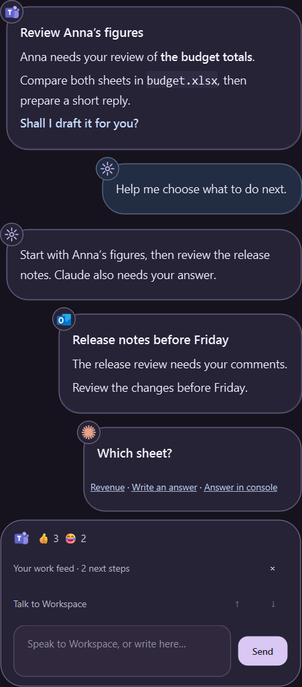

# One work conversation: first milestone

2026-10-26. This captures the user's accepted product direction, the available
access route, and the first implementation scope. See
[the primary-source feasibility report](unified-work-conversation-feasibility.md)
for Microsoft API facts and sources.

## Implemented first slice

The production source now composes Teams observations and agent turns in the
existing native Inbox. The available controls are Connect Teams,
Chats (one to eight followed chats), Refresh, Disconnect, Reply, Ask Workspace,
Seen here and Open in Teams. Replies reuse the composer with a visible exact
destination. Agent context receives source text only through an explicit Ask
Workspace action. Automatic agent/source attachment and calendar actions remain
future work.

The collector borrows the consented Edge connection and owns a background Teams
tab, preserving the original user tab. Inspection has its own page; collection
pauses if the user activates the collector. A scoped browser focus-emulation
operation lets Teams finish navigation without activating a native tab and
restores the browser state after completion, failure or cancellation. Live
inspection found sidebar selection changing before the conversation pane;
observations reject that mismatch rather than binding old messages to a new
chat.

Message identity is `(conversation, message)`. Up to 300 message observations
are retained in memory, independent of agent reset. Reactions change their
existing row without making a locally seen message new again; edited text does.
The adapter only sees loaded sidebar entries and rendered message history.
The first connection follows the current chat and up to three other chats.

Settings, followed identities, own drafts and up to 50 outgoing attempts are
stored atomically with Windows DPAPI encryption. Incoming bodies and local Seen
state are memory-only in the communication cache; explicitly selected agent
context follows the existing saved-task policy. Draft updates are coalesced independently of the action
queue and flushed at shutdown. Each send has an immutable attempt identity,
destination and text, is recorded before posting, and requires a new exact-text
message in the bound chat plus a cleared source composer as readback. This is
observed evidence, not proof of server delivery. Interrupted or ambiguous
attempts become unknown and are never replayed. After inspecting Teams, the
user can mark an unknown attempt reviewed; its original evidence remains.

The Teams API adapter remains available for a later approved Entra setup.
Normal web login does not grant Graph consent. This slice does not clear Teams
Activity or native flashing, dismiss Windows notifications, accept invitations,
or provide complete account-scoped background synchronization.

Read-only production-adapter checks on the signed-in laptop discovered 25 chats
and combined 79 rendered messages across four followed chats, with no missing
sender labels in that sample. The original Teams tab was left untouched.
Exact sends, multiline text and changing destinations were exercised only with
fictional local pages in an isolated browser profile. No real message was sent.

Validation includes 29 focused browser/communication tests, native timeline and
reply fixtures, strict checks on the changed modules, and complete source
compilation/imports. The first full Windows run reported 1,154 passes and six
failures. Follow-up corrected declared toolbar storage, the collector startup
fixture, the renamed menu expectation, and agent-turn ordering for older
question timestamps. A notification geometry test now controls animation.
Two broader findings remain: notification sizing when moving between different
screen scales, and intermittent temporary-profile cleanup in isolated owned
browser tests. The retained Shared Workspace browser surfaces
remain disconnected from Workspace startup.

The installed-window check also exposed a Qt callback binding failure when the
production Work callback was configured: the slotted AgentWindow did not permit
weak references. It now does, and a native regression opens the panel with that
callback and invokes the Work menu action. The original fixtures did not supply
this callback. The regression, complete source compilation/imports, Ruff and
strict type checks pass. Live visual checks require an unlocked Windows desktop.

## Inbox recovery follow-through

The local checkout, GitHub repository and Windows installation are now named
`workspace`. The desktop timeline is titled `Workspace · Inbox`.

Production collection now restores Chat from Activity, opens a discovered chat
when no conversation is selected, and records availability independently for
each followed chat. Observations from a usable chat are retained before another
chat is selected. A missing or loading chat no longer discards those observations
or marks every other chat unavailable. Successful later collection clears that
chat's availability warning. An exact chat link already loading is allowed to
finish instead of having its navigation restarted at every retry.
The ad hoc `threadId` query was rejected by live destination checks. Recovery
now uses Microsoft's documented `/l/chat/<chatId>/conversations` link, requests
the browser route and handles the web-launcher button by its stable identifier.
Readback must match the original conversation identity before messages or a
reply editor can be used.

Read-only live collection after the launcher correction combined 124 message
observations across four followed chats and retained the same approved browser
connection generation. The native launcher fixture verifies the exact
destination with fictional data and no external requests. Windows browser
cleanup also waits for the process exit signal after job termination instead
of issuing a second termination request during that interval.

The installed poller exposed a further redirect race: Teams can replace the
execution context between observing the launcher and reading it. Retired contexts
are now distinguished from lost browser connections, including errors returned
by a connection host started before the update. Read-only observations acquire a
fresh context, and launcher continuation can recover across that redirect. Direct
replies retain their original single-attempt semantics. Native fixtures navigate
between real local documents to exercise this transition.
Slow navigation is also a pending observation rather than a failed connection.
Subsequent polling waits for that exact navigation before selecting another chat,
so cycling the followed set cannot keep restarting an unfinished Teams startup.
The user's actual saved four-chat set was then collected through two complete
cycles: 85 messages, connected status throughout, and no unavailable chats.
This check includes the saved chat absent from the initially rendered sidebar.

Regression checks exercise initial Activity with an empty pane, saved followed
chats with no current pane, first selection from the chat list, partial collection,
availability recovery, and repeated observation of the same loading link. Native
Edge fixtures additionally exercise Activity recovery, frozen pages, exact sends,
route changes during composition and preserving drafts/selection during arrivals.
These fixtures contain fictional messages. Live diagnostics retain counts and
page structure only; no real test message is sent.

The connection host retains the approved Edge connection independently of the
assistant's lifetime. Its client and cancellation checks cover reload, ordinary
timeouts and cancellation without reconnecting the browser. A real browser exit
still requires a new browser connection.

## Personal work feed

The floating agent conversation now owns Teams items, Windows notices and
console requests. The bar forwards native observations without constructing a
second notification renderer. Opening **Your work feed** keeps the existing
speech bubbles visible and adds its composer beneath them. It does not open the
separate boxed inbox proposed in the earlier implementation.

The agent owns triage. Explicit saved visibility preferences are trusted model
instructions, separate from incoming evidence, and apply before grouping or
default urgency decisions. Quiet sources stay out of actionable groups.
Source observations become revision-bound candidates;
bounded background model calls group related arrivals into one assessment,
summarize possible work, suggest a concrete next step and optionally ask a
question. Complete open groups can be reconsidered alongside a new reminder.
Reactions stay quiet and contribute only a compact count. Informational updates
and acknowledgements can be classified quiet. Invalid, duplicate, omitted or
invented source references reject the whole model response. A response for an
old source revision or an earlier feedback generation cannot overwrite newer
work. When a grouped source changes during evaluation, stable arrivals are
retried separately so a busy chat cannot continually discard their assessments.
A failed model call retains existing proposals, reports pending review,
and retries with backoff.

The floating surface presents assessments rather than raw source copies.
Small application badges overlap each bubble's upper left edge, with source
names available through accessible labels and tooltips. Grouped work keeps its
distinct source badges. Source headers and settled-turn status headers occupy
no separate row. Titles, emphasis, lists, code and web links render in the body;
questions have a distinct accent. A single compact emoji strip in the feed
shows reaction acknowledgements without allocating action bubbles.
Manual filters, Review and the repetitive Done/Ask/Open source rows are absent
from the default feed. Console questions remain exact, visible and answerable.
The normal voice agent reads current proposals and source evidence through an
authenticated loopback tool and updates the same plan. Explicit spoken feedback
persists filtering preferences; captured proposals survive a notification disappearing
and a restart, while the voice agent can distinguish them from live evidence; completed revisions stay quiet across polls and
reloads. List disposition does not execute work or acknowledge remote Teams
activity. Incoming source text is untrusted evidence and cannot authorize sends,
command approvals, preference changes or completion. The background triage model
has no external tools.

Preferences, source hashes and plan summaries are stored atomically with Windows
DPAPI. Raw source bodies remain in memory and are sent to the configured model
endpoint for triage; integration tool previews and journals omit source content.
Workspace and Teams drafts retain their existing encrypted persistence and
single-attempt send protections. Native observations enter triage independently
of slow Teams navigation. Outlook contributes notification previews; full
mailbox access remains a later adapter.

Both CLI hook configurations are installed; Codex's one-time trust review has
completed. Native fixtures exercise Windows subprocesses waiting for answers
through the floating composer for both providers. Claude receives updatedInput;
Codex's hook denial carries model-visible answer feedback because its protocol
has no native question-result replacement. Interruption/expiry/close returns
control to ordinary CLI interaction without approving anything.

Validation includes pure source/projection checks and native
floating-feed, agent-bubble and bar regressions, including short-screen paging
through every pending item. The installed check separately
verifies source/ZIP identity, fresh core readiness, the retained Edge connection,
exact Windows notice delivery and the visible floating feed. Fixtures use only
fictional messages and local commands.

## Accepted broader direction

Colleague messages, the user's replies, agent requests/results, and actionable
updates share one conversation-shaped representation. A user can reply to an
identified exchange, ask the agent for help with it, and return to its attached
result without navigating between applications. Related activity groups
together; reactions update their original message quietly. Meeting updates
have their own source and available actions within this same surface.

The user explicitly rejected side-by-side chat windows. This is a single
representation with preserved source identities and conversation context.
Keep the existing Windows Python/Qt runtime, bar and isolated keyboard process.
The separate Shared Workspace canvas remains outside Workspace startup.

## Evidence from this laptop

Read-only probes used the deployed Windows bundle's interpreter and existing
Workspace adapters. Results below contain structure and counts, not private
message text, account IDs, tokens or browser profile data.

| Check | Observed result |
| --- | --- |
| Teams Graph configuration | No saved app configuration or API sign-in. Client/tenant environment settings were absent from process, user and machine scopes. |
| Company access | User confirmed that app access still needs to be arranged, and asked to use normal login instead. |
| Desktop Teams | One Teams window was running. |
| Windows notification listener | Access allowed; 36 Notification Center entries at observation time, zero labeled Teams. This sample does not establish the cause of flashing. |
| Edge browser connection | The browser-owned debugging endpoint existed. The user confirmed Teams web was signed in and allowed the connection. |
| Teams page attachment | Succeeded; one selected Teams tab at `teams.cloud.microsoft`, 65 visible controls, and 4,162 characters in the bounded visible-text snapshot. Private text was not printed or saved. |
| Current chat page structure | Eight rendered numeric `data-mid` message identifiers, one visible editable composer, a chat title and sender label, and conversation-shaped identities in DOM attributes including `data-fui-tree-item-value` and `data-track-thread-id`. |
| Interaction effects | No messages sent, drafts filled, chats navigated, notifications dismissed, or app settings changed. Existing Teams tab remained open after probes. |

The first short probes disconnected immediately after reading; this was an
intentional `Browser.close()` in their cleanup, not an attachment failure. The
user reported the confusing repeated disappearance. A subsequent temporary
probe retained one connection for multiple checks and closed it after the
session finished. Production must retain a single owned browser connection
across observations rather than prompting separately for each read.

**Conclusion:** normal Teams web login plus browser connection consent works for
reading this laptop's currently rendered conversation. No separate Workspace
Graph app was needed for that observation. Complete background coverage,
reaction updates, exact direct replies and the cause of flashing remain
unverified. The DOM observations are version-specific, not Microsoft API
contracts.

## Reviewable interaction prototype

The isolated worktree at
`/home/jim/workspace-prototypes/unified-work-conversation-20261026` captures a
single-file demo under `experiments/unified-work-conversation/prototype.html`.
It uses fictional data, in-memory state, no network calls, and no persistence.
Open the HTML file directly in a browser. A standalone copy is also supplied in
Windows Downloads as `workspace-work-conversation-prototype.html`.

Captured on branch `prototype/unified-work-conversation-20261026`, commit
`52c447a`. The prototype's state model and guided walkthroughs show:

- A reply to one chat keeps its destination and draft when another chat updates.
- Reactions stay attached and a meeting time updates its existing item.
- An explicitly invoked agent request/result remains attached to its source.
- An uncertain send retains its original destination/text and is reconciled
  without an automatic resend.

All four guided walkthroughs ran in an isolated headless Chromium process
without page errors. This is an interaction demonstration, not validation of
live Teams delivery. No production state-machine decision has been validated
by user review yet; the HTML shell stays on the throwaway branch.

## First production slice

Use the consented Teams web route first, since it is the available route. Begin
with a small, explicit set of existing conversations and a read-only projection
beside existing agent turns in the **same native conversation view**.

1. Retain the browser connection and exact Teams page instance. Navigation,
   detach, account changes or login expiry invalidate previously captured
   reply targets. Leave user's unrelated browser tabs untouched.
2. Adapt rendered messages into typed observations with provider, account scope,
   conversation identity, message identity, sender, source revision, text,
   coverage and observation time. Do not route from display names alone.
3. Establish stable identity mapping between the conversation list, current
   header, messages and composer. The current probe finds candidate attributes;
   mapping correctness across a chat switch must still be demonstrated.
4. Give Workspace an explicitly selected background Teams tab for collection if
   navigation is necessary. Never change a chat the user is reading to poll
   another conversation. Measure load cost and coverage before promising an
   all-chat live stream. Page virtualization makes unopened histories unknown.
5. Cache bounded observations and reconcile updates by source identity. Expose
   partial coverage and disconnected/stale observations in the view. Preserve
   drafts, scroll/selection, and locally acknowledged updates during arrivals.
6. Add exact-destination direct replies only after the read-only projection is
   dependable. Show the destination, freeze it with the draft at submission,
   send once, and bind readback evidence to the attempt. Never resolve an
   uncertain send merely because a similar message exists.
7. Attach explicitly requested agent work to a frozen source exchange. Incoming
   messages are source data, not new agent instructions. Use existing durable
   task identities so results remain reachable after a conversation reset.

Source messages share a UI with agent work; they do not automatically become
the model's conversation. Asking the agent about an item supplies that selected
context. A direct Teams reply goes through the communication controller and
does not require a model turn.

## Source seams

| Existing owner | Change needed |
| --- | --- |
| `assistant/browser.py`, `browser_session.py` | Reuse the existing consent, page ownership, cancellation and observation mechanisms. Retain one connection and scoped page identity. |
| `assistant/teams.py`, `graph_http.py` | Keep the structured Graph route available for later permitted setup. It needs richer observations, history pagination, throttling metadata and sync before it can drive the same projection. |
| `assistant/system_notices.py`, `system_toasts.py`, `winapi/notifications.py` | Separate Windows notice identity and dismissal from communication source identity; never infer a reply destination from a notification title. |
| `assistant/agent_session.py`, `agent_window.py`, `agent_panel.py` | The current session only models agent/meeting entries. Add a presentation composition boundary for communication observations rather than pretending an incoming colleague message was said by Workspace. Preserve existing question/input routing. |
| `assistant/work_agent.py`, `work_window.py`, `automation/task.py` | Bind explicit agent assistance to source identity and task identity; preserve existing execution and recovery ownership. |
| `assistant/app.py`, `ui.py`, `desktop_bar.py` | Compose the communication observer and view. Keep network, page reading and storage off UI, keyboard and audio loops. |

The timeline needs its own bounded communication history and draft ownership
independent of resetting an agent session. Define retention and persistence
before storing private message bodies; current Windows-notification code
retains no such durable bodies.

## Notification and calendar follow-through

Investigate four separate states: Windows notice dismissal, Workspace local
acknowledgment, Teams chat read markers, and Teams Activity/flashing. Clearing
one is not evidence that another cleared. The user's reported flashing did not
occur during the read-only probes, so its cause remains open.

The Graph route has documented `markChatReadForUser` under delegated
`Chat.ReadWrite`; current Workspace scopes do not include it. Ordinary login does
not grant that API scope. Browser actions may provide a UI-based route to
acknowledgment, but must be observed against the specific reaction/invite/chat
case before implementation. `FlashWindowEx(FLASHW_STOP)` only stops current
native flashing and does not disable future app attention requests.

Calendar invitation actions need their own event identities and access. Initial
meeting items can show observed updates, but acceptance/decline must stay
unavailable until the exact event and supported operation are established.

## Acceptance for the broader direction

- Existing mapped chat messages appear alongside agent turns, with source and
  reply destination visible.
- Repeated observation and reconnect do not duplicate a known message.
- Coverage is explicit; no claim of unseen or unread chats based only on a
  currently rendered page.
- New arrivals preserve the user's composer, scroll position and draft.
- A chat switch invalidates stale targets and cannot redirect a captured reply.
- Disconnect/sign-in expiry retains observed content as stale and prevents
  sending through an unverified target.
- An agent task remains attached to its originating exchange.
- Real send validation uses an exact message and recipient supplied by the
  user. No unsolicited test message is sent.

The native implementation uses the Windows source-release workflow.
Direct replies are validated against fictional local Teams-shaped pages;
no test message is sent to a real colleague. Live checks validate login reuse,
chat discovery and read-only collection. Complete calendar operations and
all-chat/history coverage remain separate follow-through work.

## Actionable inbox implementation, 2026-10-26

The default view is now **Pending**: a followed chat contributes one ticket,
showing its latest pending message. Earlier context expands within the same
flow. Teams Activity rows and Windows notifications have their own source keys,
with **Done**, **Ask Workspace** and source-opening actions. **History** retains
handled entries for inspection or reopening; **Clear reactions** handles the
captured reaction batch. Agent questions and exchanges keep their existing
identity and composer in this view.

Handling saves exact source keys and SHA-256 content fingerprints under DPAPI.
Incoming bodies remain memory-only. A concurrent arrival or edit is not covered
by an earlier handling command. Verified outgoing replies handle only their
captured chat revisions, and their readback remains identified as the user's
own message. Unknown sends retain both pending work and attempt evidence.

Teams Activity uses a second background tab on the same approved host. Numeric
activity wrapper IDs identify rows independently of display names. Relative
timestamp labels are excluded from content fingerprints. **Done** opens the
specific row's context menu, uses **Mark as read**, and checks that the same menu
then offers **Mark as unread**. An already-read row requires no toggle. Missing
rows, unsupported labels and failed readback produce an explicit unconfirmed
source status; local handling is not described as proof of native read state.
This does not establish that Teams desktop flashing or every unread badge cleared.
Opening an activity activates its exact saved CDP page. A native browser fixture
reproduced the earlier failure after session-local native tab metadata was lost;
source opening now works independently of that metadata and across reloads.

Windows notice delivery now enters the same inbox, and glass-card activation
opens it. Handling or closing a card saves local handling before asking the
listener to remove the exact notice. The observer leases each registered app's
`ShowBanner` setting while access is allowed, keeping delivery and Notification
Center settings intact. The registry journal survives restart and restores prior
values on exit. Access denial or repeated failed reads releases the lease. Newly
registered sources are reconciled on later polls; their first notification can
precede that reconciliation. App-drawn windows do not use this Windows setting.

Live checks observed 17 Activity rows (11 reactions and 6 other updates) through
the retained approved connection. An already-read real Activity row's native
status was confirmed without toggling it. Fixture tests exercise unread-to-read
transition, idempotent rechecking, missing identity and changing relative clocks.
No test reply was sent to a colleague.

On the installed Windows account, 86 registered sources initially had banners
enabled/defaulted; banner-setting readback verified all 86 at zero with no write
failures. A local WinRT test still reached Notification Center. The controlled
test did not reproduce the user's native banner before suppression, so setting
readback and continued delivery are the evidence for this change; they do not
prove that every app-drawn popup is covered. A native geometry regression also
caught monitor DPI changes resizing a glass card after layout; its dismiss
control now follows the resulting logical bounds.

Invitations can be handled, discussed with Workspace, or opened in Teams/Outlook.
Accepting or declining them still requires the source application's calendar
operation. The current inbox deliberately reports local pending tickets rather
than claiming complete Teams unread or invitation coverage.
